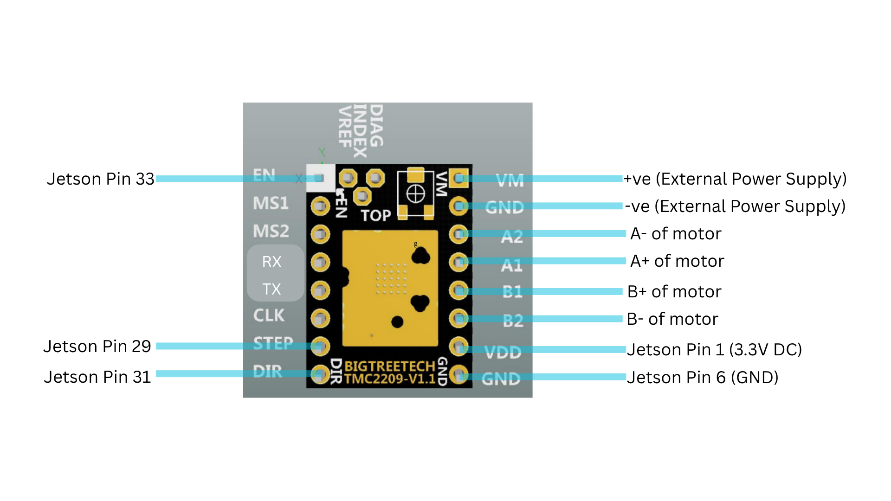

# System Setup, Operation, and Troubleshooting

This guide describes the current benchtop system in `laser_position_calibrated_control_package/`. Scripts print their own prompts and interaction instructions; the terminal and camera window are the source of step-by-step instructions during a run.

## 1. Hardware and safety

- Jetson Orin Nano / Orin Nano Super runs the Python controller.
- The USB camera connects to the Jetson through USB-A.
- The Waveshare ESP32 servo-driver board connects to the Jetson through USB-C and supplies the ST3215 servo from a separate 12 V, 3 A supply.
- The FUYU FPB 30E500RB42 linear actuator is driven by a BigTreeTech TMC2209. It uses a separate 12 V supply. The Jetson, driver logic, and driver ground must follow the supplied wiring reference.
- The actuator driver wiring is annotated below. Jetson BOARD pins are STEP 29, DIR 31, and EN 33; the diagram also shows 3.3 V logic and ground.




- High-power laser equipment appears in the earlier enclosed test media below. The active `green_weed_moving_tracker.py` contains no laser output control; its simulated treatment stage does not fire a laser.
- Positioning tests should begin with the laser disconnected or disabled. A Class 4 laser requires a suitable enclosure, interlocks, emergency stop, correct eyewear, beam control, and approved operating procedures before any firing code is introduced.
- The approximate laser mount height recorded for the project is 12-13 inches (about 0.32 m) above the ground. This is not a substitute for calibrating the actual target plane.


## 2. Startup sequence

1. Check the mechanical travel path and ensure that the actuator and servo can move without contacting the frame, cables, or people.
2. Connect the USB camera to the Jetson. Connect the servo driver by USB-C. Power the servo driver from its 12 V, 3 A supply and the linear-actuator driver from its separate supply.
3. Enable the Jetson pin configuration required by the actuator. These commands must be run again after each reboot:

   ```bash
   sudo busybox devmem 0x2430068 w 0x8
   sudo busybox devmem 0x2430070 w 0x8
   ```

4. Enable servo Serial Forwarding:
   - Connect the controlling computer/Jetson to the driver's Wi-Fi network `ESP32_DEV`.
   - Wi-Fi password: `12345678`.
   - Open `http://192.168.4.1/` in a browser.
   - Select **Start Serial Forwarding**.
   - Confirm the USB-C cable is connected between the driver and Jetson. The Python controller communicates through `/dev/ttyUSB0` at 115200 baud while forwarding is enabled.

5. Start the current green weed tracker from its package directory:

   ```bash
   cd ~/devansh/laser_position_calibrated_control_package
   sudo /home/sunoj-orin/venvs/weed-yolo/bin/python green_weed_moving_tracker.py
   ```

6. Read the terminal prompts. Confirm the actuator's saved midpoint only when the carriage is physically at that midpoint. The controller requires the explicit text `GO` before starting motion.

The absolute Python path selects the Jetson virtual environment where the controller's Python packages are installed. The green tracker uses its own hard-coded HSV settings and ignores the saved JSON settings file.

## 3. The two calibrations

The project uses two separate calibration processes. They solve different problems and both must be valid.

### A. Servo limits and actuator travel

- `servo_calibration.json` stores the servo's permitted position range and the actuator's travel in software steps.
- The current file in the supplied archive records servo positions **1930-2171**, actuator travel **12954 steps**, and saved midpoint **6477 steps**.
- The startup midpoint confirmation is essential because the actuator has no encoder or physical limit switches. Its position is estimated from step pulses.
- `run_yolo_stable_auto_visit.sh` is a retained calibration/jog utility. Despite its name, it launches the older `laser_servo_tracker_yolo_stable_auto_visit.py`, not the active green detector. Read its terminal prompts and confirm the script's limits before using it to calibrate endpoints.
- `servo/st3215_servo.py` is a standalone servo diagnostic. Its default sweep range is set by `LIMIT_DEG`, but its manual jog commands use the full 0-4095 range in the supplied source. It must not be treated as a hardware safety interlock or as enforcing the green tracker's narrower limit.

### B. Camera pixel to servo/actuator position map

- `position_map.json` maps a pixel `(x, y)` in the camera frame to an absolute servo command and actuator step position.
- The current map in the supplied archive is `SCATTERED`, 1280 x 720, with 32 recorded samples. The active tracker rejects target points outside the measured calibration region instead of commanding extrapolated positions.
- The recommended calibration tool is `calibrate_position_map_multiplacement.py`. Its A4 sheet is in `position_map_calibration_A4.pdf`.
- At each sheet placement, the four outer crosses (#1, #6, #30, and #25) are recorded. The sheet should remain flat in the same physical target plane and be moved to different regions of the working area between placements.
- Four placements provide 16 samples; five placements provide 20 and are recommended when the space allows. Samples should surround the intended working area rather than cluster in one region.
- For every sample, the camera pixel must correspond to the physical point that the positioning reference is aimed at. More distinct samples improve coverage, but a low training RMSE does not prove physical accuracy. Separate points should be reserved for validation.
- The A4 sheet is a convenient reference, not a geometric requirement. Other clearly marked points can be used if each point is paired with the motor positions that physically align to that exact point, and all points stay on the same plane.
- After saving the map, the annotated sample geometry can be inspected with `position_map_hull_inspector.py`. The output folder `calibration_snapshots/` is intended for timestamped annotated calibration images.
- **Known issue in the supplied archive:** the calibration screenshot-save block uses `SCRIPT_DIR`, but that name is not defined elsewhere in `calibrate_position_map_multiplacement.py`. If a `NameError` occurs after the map-save message, the map may already have been written. Define `SCRIPT_DIR = os.path.dirname(os.path.abspath(__file__))` near the imports before relying on the screenshot-save step. The calibration script also uses relative paths, so it should be launched from its package directory.

### Keep the camera and target plane consistent

- The map expects 1280 x 720 image coordinates. Camera position, lens/view, and calibration-plane geometry must not change after calibration.
- All map samples and operating targets should lie on the same physical plane. A change in height or depth introduces parallax and can produce position-dependent error.
- `position_map.py` uses triangle interpolation within the measured sample hull and a quadratic estimate outside it. The green tracker does not use extrapolated positions for normal motion.
- `position_map_hull_inspector.py` is a display/debug tool only and does not command motors. It can show the sample hull and classify saved or clicked points.

## 4. Weed detection and tuning

The active `green_weed_moving_tracker.py` uses green HSV segmentation, not YOLO. Its current hard-coded values are:

| Parameter | Current value |
|---|---:|
| `GREEN_H_MIN` / `GREEN_H_MAX` | 30 / 95 |
| `GREEN_S_MIN` / `GREEN_S_MAX` | 36 / 255 |
| `GREEN_V_MIN` / `GREEN_V_MAX` | 128 / 255 |
| `MIN_GREEN_CONTOUR_AREA` | 2000 pixels |
| `MORPH_OPEN_SIZE` | 3 |
| `MORPH_CLOSE_SIZE` | 7 |

- Lighting, camera exposure, background, weed colour, and target size can change these values' suitability.
- `green_weed_detection_tuner.py` is the tool for viewing and adjusting segmentation thresholds. The tracker intentionally ignores `green_weed_detection_settings.json`; after tuning, the accepted values must be copied into the constants in `green_weed_moving_tracker.py`.
- A larger minimum contour area removes small green regions but can miss small weeds. Morphological opening removes small fragments; closing fills gaps but can join nearby green regions.
- The tracker draws accepted contours and tracked boxes, and records annotated video under `recordings/`.


## 5. Positioning and repeatability tools

- `click_point_position_test.py` moves the servo and actuator to a clicked image point using the saved position map. It is useful for isolating mapping from weed detection.
- `laser_repeatability_test.py` supports saved target points, direct point-to-point positioning, manual laser-spot measurements, and an automatic positioning sequence. It records annotated test video and CSV results under `repeatability_results/`.
- Physical error in millimetres is reported only when `pixel_to_mm_homography.json` is available and valid. Without it, pixel error is diagnostic and should not be converted using a single pixels-to-millimetres scale.
- The automatic positioning sequence cannot measure actual laser spot error without a suitable visible spot and measurement procedure.
- The sample recording below shows a repeatability-test camera view. The raw video is linked for review.

<video width="1280" controls>
  <source src="media/repeatability_video_20261030_123323.mp4" type="video/mp4">
</video>

## 6. Practical checks and common mistakes

- **The carriage moves inaccurately:** the actuator has no encoder. A pulse counter cannot detect missed steps. Use conservative speed/acceleration, check the physical endpoint at repeated targets, and do not assume the software step count equals real position.
- **A target is rejected as outside the calibration hull:** inspect the point and hull. Reposition the target or add calibration samples around that part of the workspace; do not disable the safety check to force a move.
- **The cross is correct but the physical pointer misses:** investigate the position map, camera/target-plane geometry, servo response, actuator repeatability, and possible lost steps. A single offset cannot correct an error that changes across the workspace.
- **A weed is not detected:** use the tuner under the current lighting, then copy the selected threshold values to the active tracker's source constants. Saving the tuner JSON alone does not update the tracker.
- **The servo does not respond:** verify driver power, USB-C connection, Serial Forwarding, servo ID 1, and 115200 baud. The board is an ESP32 servo driver, not a plain USB-to-serial adapter.
- **The actuator does not move:** run the pinmux commands again after reboot, check driver supply and wiring, and confirm the physical midpoint before enabling motion.
- **Unexpected package errors under `sudo`:** run scripts with the documented virtual-environment interpreter rather than an unrelated system Python.
- **Unrelated `apt update` / `apt upgrade` warnings:** the Jetson has had earlier browser/system-file experiments. The exact changes are not documented; inspect the specific warning before altering or replacing OS files.

## 7. Servo safety limits

- The active green tracker clamps servo commands to **1930-2171**, with center **2056**.
- These are software limits, not physical stops. They reduce travel but cannot prevent a wiring fault or incorrect controller outside this code path.
- The standalone `servo/st3215_servo.py` permits wider manual jogging in the supplied source. It requires an additional, independently verified travel limit before being used in a laser-equipped setup.
- The current tracker does not set laser power or duration and does not fire the laser. This must remain explicit in all system demonstrations and research claims.

## 8. Directory guide

```text
README.md                                  GitHub landing page
docs/HOW_TO_USE_SYSTEM.md                  system operation guide
docs/LEARNING_SUMMARY.md                   development record
media/                                     hardware photos, views, video, poster, QR asset
camera/                                    older camera / bright-spot / YOLO / TensorRT tests
laser_position_calibrated_control_package/
  green_weed_moving_tracker.py             active green-threshold tracker
  green_weed_detection_tuner.py            HSV tuning preview
  calibrate_position_map_multiplacement.py sparse camera-to-motor map calibration
  position_map.py                          map interpolation and loading
  position_map.json                        saved camera-pixel-to-motor map
  servo_calibration.json                   safe servo range and actuator travel
  position_map_hull_inspector.py            map coverage viewer, no motor motion
  click_point_position_test.py              click-to-position test
  laser_repeatability_test.py               positioning repeatability measurements
  laser_servo_tracker_yolo_stable_auto_visit.py retained legacy controller / calibration utility
  laser_servo_tracker_actuator_jog_shutdown_fixed.py earlier non-YOLO controller
  actuator_driver.png                      annotated TMC2209 wiring
motor/                                     standalone actuator and UART experiments
servo/                                     servo tests, safety/diagnostic script, older trackers
requirements.txt                           base Python dependencies
```
