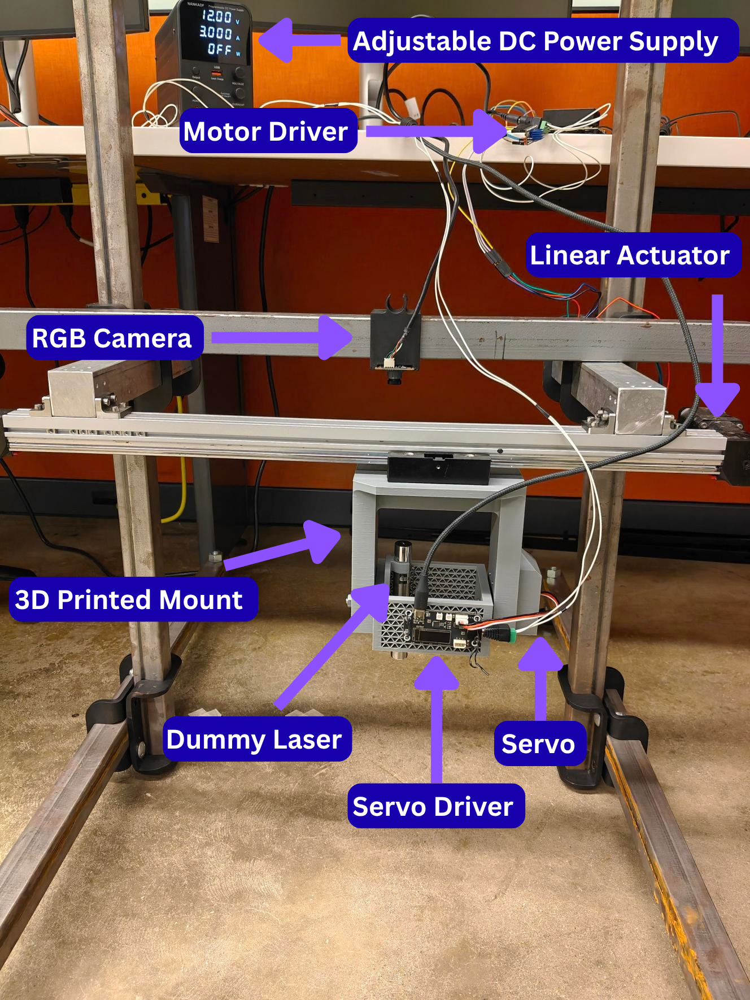
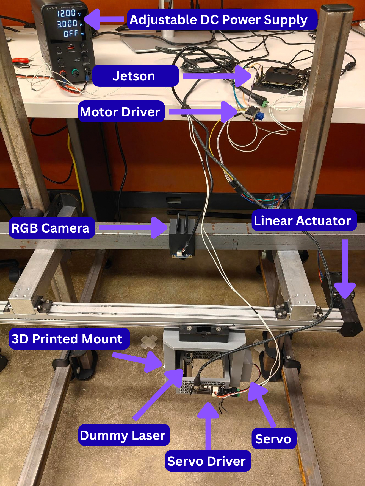
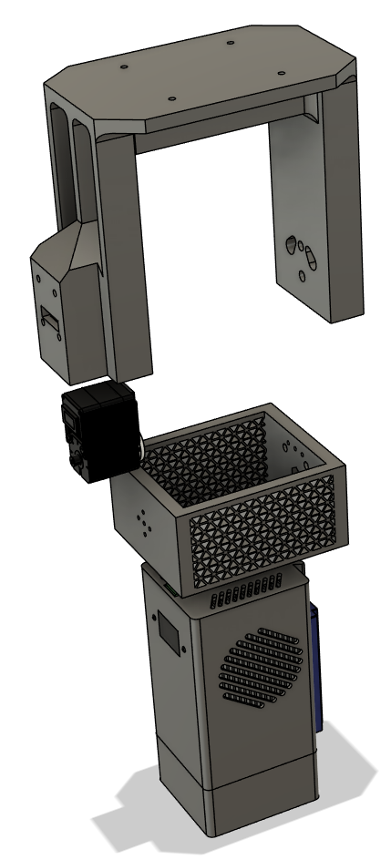
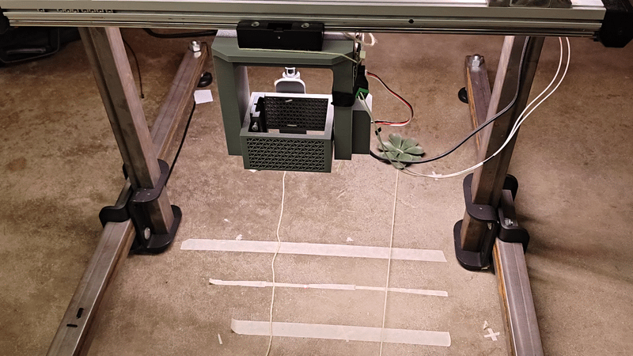
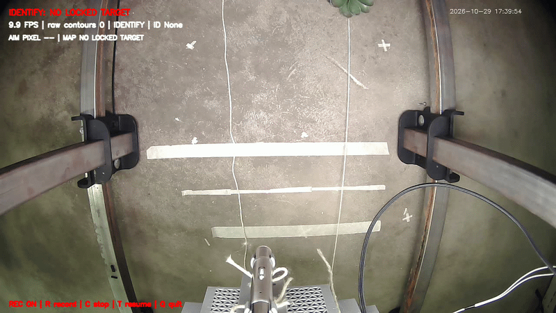
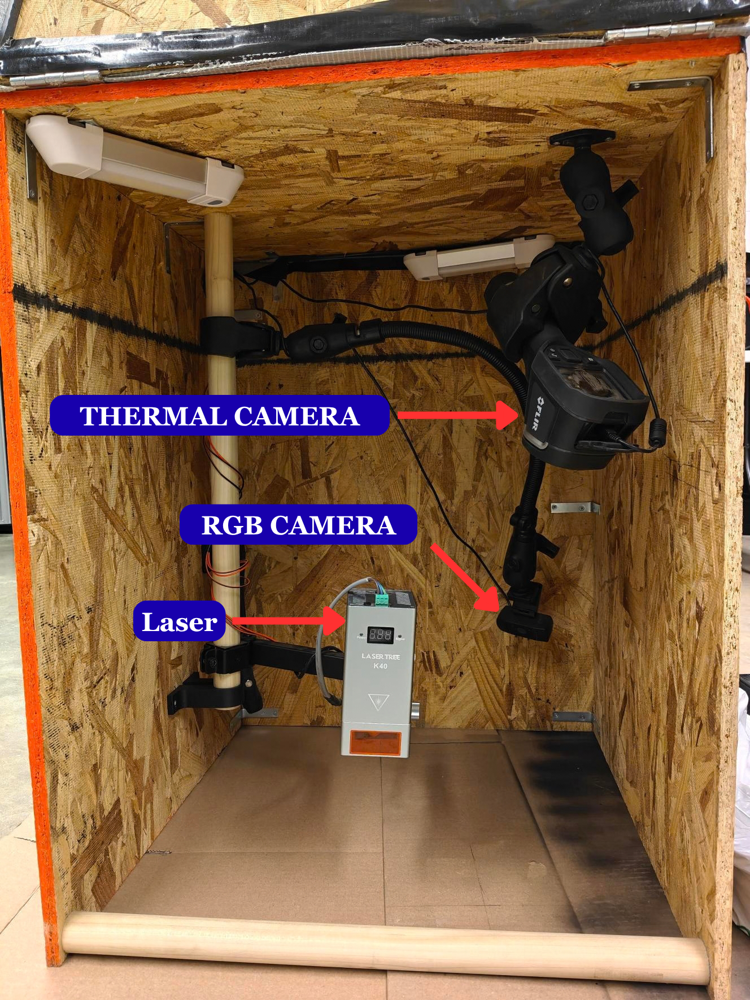
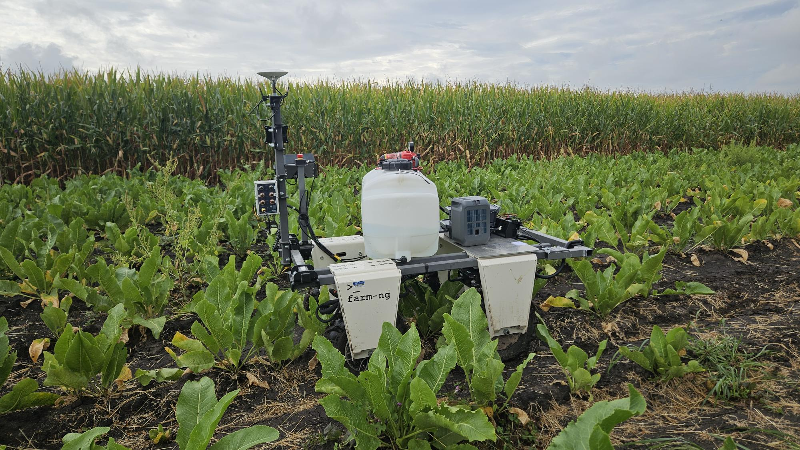

# Low-Cost Modular Laser Weed-Management System

A research prototype for camera-guided weed targeting in specialty crops, with horseradish as a motivating application. The system combines a USB camera, an ST3215 servo, a stepper-driven linear actuator, and a calibrated camera-pixel-to-motor-position map.

**Project team:** Devansh Rungta, Seth Van Hoveln, and Sunoj Shajahan. Agricultural and Biological Engineering, University of Illinois Urbana-Champaign; Agricultural & Food Engineering, IIT Kharagpur.

## Current implementation

- **Active tracker:** `laser_position_calibrated_control_package/green_weed_moving_tracker.py`.
- **Detection:** hard-coded HSV green segmentation and contour tracking. The current tracker does not use YOLO or load `green_weed_detection_settings.json`.
- **Positioning:** `position_map.json` maps camera pixels to servo and actuator commands. The map is calibrated for one fixed target plane.
- **Actuation:** ST3215 servo for one axis and a TMC2209-driven linear actuator for the other. The actuator is open-loop; commanded steps are not measured physical position.
- **Laser integration:** the active green tracker has no laser trigger or power/duration control. Its treatment stage is simulated. The runtime should be considered a positioning test until laser-control and safety integration are separately completed and validated.

## Prototype and media

### Mechanical setup



*Camera, linear actuator, servo, driver, power supply, and custom mount on the benchtop rig.*





### Test and runtime views





### Research context



*This image records an enclosed laser-test setup.*



*Mobile integration is a future step; the current control workflow is a benchtop test.*

## Quick start

The full startup, calibration, safety, and troubleshooting procedure is in the [system guide](docs/HOW_TO_USE_SYSTEM.md). In brief, the operator powers both motion systems, enables the Jetson actuator pins, starts Serial Forwarding on the servo driver, confirms the saved actuator reference, and then starts the green tracker.

```bash
sudo busybox devmem 0x2430068 w 0x8
sudo busybox devmem 0x2430070 w 0x8
cd ./laser_position_calibrated_control_package
sudo python green_weed_moving_tracker.py
```

The startup prompt must only accept the saved midpoint when the carriage is physically at that position. The script also requires an explicit `GO` confirmation before motion begins. Read the terminal and on-screen prompts during operation.

## Documentation

- [System guide: setup, operation, calibration, safety, and troubleshooting](docs/HOW_TO_USE_SYSTEM.md)
- [Development and learning summary](docs/LEARNING_SUMMARY.md)

## Repository layout

- `laser_position_calibrated_control_package/` - active green tracker, tuner, calibration map code and data, repeatability tests, point-position test, hull inspector, and retained controller versions.
- `servo/` - standalone ST3215 servo testing and earlier servo-tracker experiments.
- `motor/` - standalone actuator, step/dir, and UART test utilities.
- `camera/` - earlier camera, bright-spot, YOLO, and TensorRT experiments.
- `media/` - annotated hardware photos, controller views, the repeatability video, platform image, and poster.
- `docs/` - operator guide and development history.
- `requirements.txt` - small base dependency list; the Jetson-specific environment also needs hardware and vision packages available to the selected Python interpreter.
