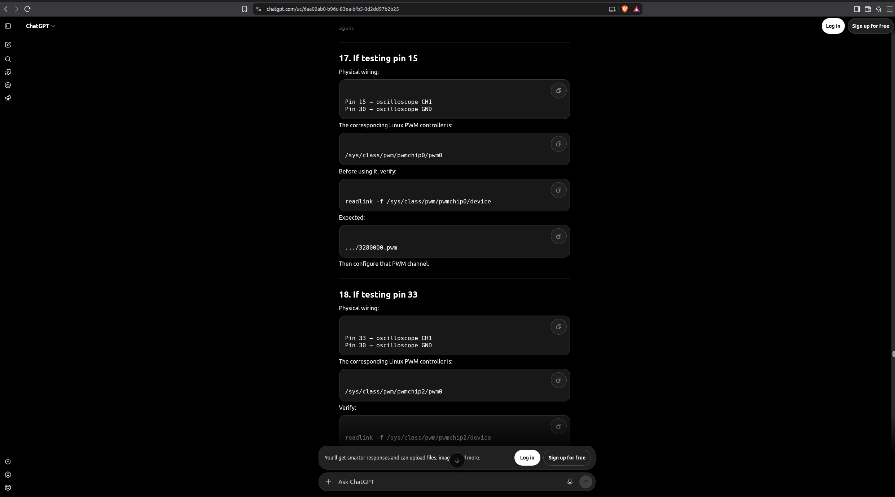

### The relevant PWM-capable header pins to investigate later are:
- Pin 15 → PWM1
- Pin 32 → PWM7
- Pin 33 → PWM5

### Oscilloscope initial configuration
- Vertical scale: 1 V/div
- Horizontal scale: 500 us/div
- Coupling:        DC
- Trigger source:  CH1
- Trigger type:    Rising edge
- Trigger level:   approximately 1.5 V

### Known mappings
- PWM1 → 3280000.pwm → pwmchip0
- PWM5 → 32c0000.pwm → pwmchip2
- PWM7 → 32e0000.pwm → pwmchip3

